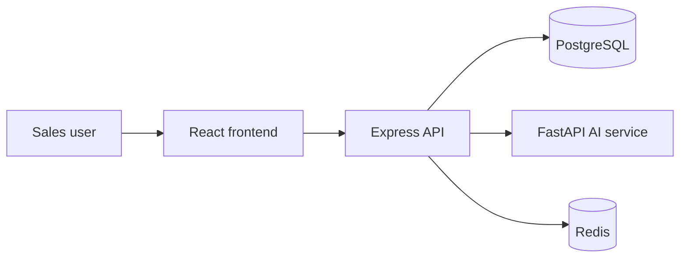
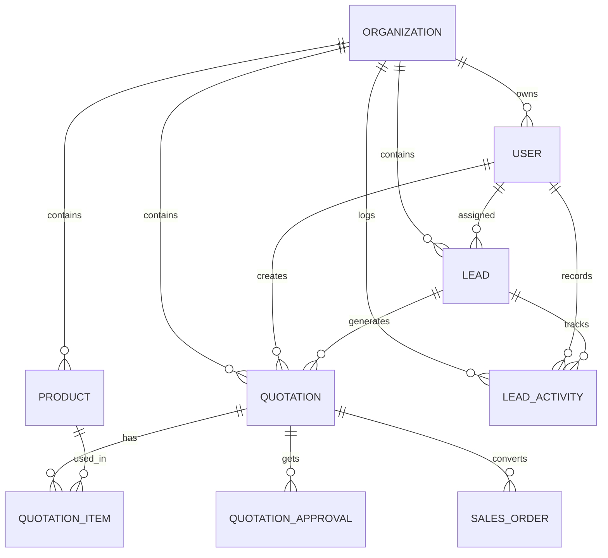

# AI-Powered Lead & Quotation Management System

## Architecture overview

This project is organized as a monorepo with three runtime services:

- Frontend: React + Vite + Tailwind for the business dashboard and workflows.
- Backend: Node.js + Express + PostgreSQL + JWT for orchestration and authorization.
- AI service: Python + FastAPI for lead summaries, quotation proposals, and email drafting.



The system is designed around organization-scoped data, role-based permissions, and server-side validation for pricing and approval rules. The backend is the source of truth for all business policies, while the React frontend renders views and captures user actions without bypassing those rules.

## Database relationship model



Core tables created in Milestone 1 include organizations, users, leads, and lead_activities. The rest of the sales domain tables are scaffolded in the design and will be added in subsequent milestones.

## Repository setup

Run the following commands from the repository root:

```bash
npm install
cp .env.example .env
docker compose up -d postgres redis
npm run dev:backend
npm run dev:frontend
cd apps/ai-service && python -m venv .venv && source .venv/bin/activate && pip install -r requirements.txt && uvicorn app.main:app --host 0.0.0.0 --port 8001 --reload
```

The frontend is available at http://localhost:5173, the backend at http://localhost:4000, and the AI service at http://localhost:8001.

## Required environment variables

See [.env.example](.env.example) for the default values.

- PORT
- NODE_ENV
- JWT_SECRET
- JWT_EXPIRES_IN
- DB_HOST
- DB_PORT
- DB_NAME
- DB_USER
- DB_PASSWORD
- REDIS_URL
- FRONTEND_URL
- AI_SERVICE_URL
- LLM_API_KEY
- LLM_MODEL
- LOG_LEVEL

## Milestone 1: repository setup, PostgreSQL schema, authentication, and application layout

This milestone establishes the foundation for the rest of the system.

### Included in this release

- Monorepo structure for frontend, backend, and AI service.
- Docker Compose setup for PostgreSQL, Redis, backend, frontend, and AI service.
- PostgreSQL migration for organizations, users, leads, and lead activities.
- JWT-based authentication with role-aware middleware.
- Admin seeding logic for a default organization and default admin user.
- Express backend with health and auth endpoints.
- Vite + React + Tailwind frontend with login and dashboard layout.
- FastAPI AI service with documented endpoints and structured models.
- CI workflow scaffold for backend, frontend, and AI checks.
- Automated auth tests for login and profile routes.

### Files created or changed

- [package.json](package.json)
- [docker-compose.yml](docker-compose.yml)
- [.env.example](.env.example)
- [.github/workflows/ci.yml](.github/workflows/ci.yml)
- [apps/backend/package.json](apps/backend/package.json)
- [apps/backend/src/app.js](apps/backend/src/app.js)
- [apps/backend/src/server.js](apps/backend/src/server.js)
- [apps/backend/src/config/index.js](apps/backend/src/config/index.js)
- [apps/backend/src/db/pool.js](apps/backend/src/db/pool.js)
- [apps/backend/src/middleware/auth.js](apps/backend/src/middleware/auth.js)
- [apps/backend/src/routes/auth.routes.js](apps/backend/src/routes/auth.routes.js)
- [apps/backend/src/services/auth.service.js](apps/backend/src/services/auth.service.js)
- [apps/backend/migrations/001_init_schema.sql](apps/backend/migrations/001_init_schema.sql)
- [apps/backend/tests/auth.test.js](apps/backend/tests/auth.test.js)
- [apps/frontend/package.json](apps/frontend/package.json)
- [apps/frontend/src/App.jsx](apps/frontend/src/App.jsx)
- [apps/frontend/src/main.jsx](apps/frontend/src/main.jsx)
- [apps/frontend/src/context/AuthContext.jsx](apps/frontend/src/context/AuthContext.jsx)
- [apps/frontend/src/pages/LoginPage.jsx](apps/frontend/src/pages/LoginPage.jsx)
- [apps/frontend/src/pages/DashboardPage.jsx](apps/frontend/src/pages/DashboardPage.jsx)
- [apps/ai-service/app/main.py](apps/ai-service/app/main.py)
- [apps/ai-service/requirements.txt](apps/ai-service/requirements.txt)

### Backend auth endpoints

- POST /api/auth/login
- GET /api/auth/me
- POST /api/auth/logout

### Validation and security notes

- Passwords are never stored in plaintext; they are hashed before persistence.
- JWTs are validated server-side and checked for organization and role context.
- Input validation is enforced with Zod on the backend and Pydantic on the AI service.
- Organization and permission boundaries are enforced in the middleware layer and will be extended throughout later milestones.

### Run and test commands

```bash
npm install
npm --workspace apps/backend test
npm --workspace apps/backend run lint
npm --workspace apps/frontend run build
```

Milestone 2 will extend the system with lead management, follow-up recording, and activity history. Once you confirm this foundation, I’ll move to the next milestone and add the lead workflow with relevant database tables, API endpoints, and UI screens.
